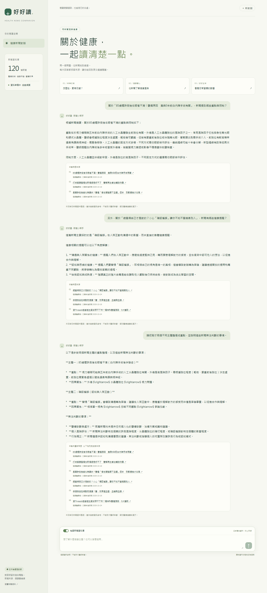

# hw3-chinese-health-rag

好好讀・RAG 健康諮詢小幫手

以健康醫療網新聞建立可追溯來源的繁體中文多輪問答，改寫課堂 [cases/RAG](https://github.com/telunyang/python_nlp/tree/main/cases/RAG) 與 [cases/ollama](https://github.com/telunyang/python_nlp/tree/main/cases/ollama) 流程。

列表 → SQLite 全文 → 地端 Gemma 摘要 → bge-m3 摘要向量 → FAISS → Flask 多輪問答。每輪由程式附上新聞標題、原始連結與發布日；關閉檢索時沿用這段對話先前的來源，明確標記「本輪未重新檢索」。資料不足時不生成沒有來源支持的答案。

## 本機設定

- Python 3.12；GTX 1660 Ti 6 GB；PyTorch 2.11.0 + CUDA 12.8。
- 地端生成：`gemma4:e2b-it-q4_K_M`，明確固定 Q4_K_M 標籤。模型標籤與實際下載大小見 [官方頁面](https://ollama.com/library/gemma4:e2b-it-q4_K_M)。
- 向量：`BAAI/bge-m3`，摘要正規化後以內積計算 cosine，`IndexIDMap(IndexFlatIP)` 對應 SQLite id。
- 建索引：先卸載本專案的 Ollama 模型，bge-m3 使用 GPU、batch 8、最多 512 tokens。
- 問答檢索：bge-m3 固定 CPU，GPU 留給 Ollama；top-3、門檻 0.45。這是初始門檻，會以實際檢索結果檢查，尚未宣稱經人工標註調校。

## 啟動背景流程

```powershell
cd hw3-chinese-health-rag
py -3.12 -m venv .venv
$taskPython = (Resolve-Path .\.venv\Scripts\pythonw.exe).Path
Start-Process -FilePath $taskPython -ArgumentList 'run_background.py','--limit','120','--pages','6' -WorkingDirectory (Get-Location).Path -WindowStyle Hidden
Get-Content .\state.json -Raw | ConvertFrom-Json
```

流程會安裝套件、下載官方 Ollama 可攜版到 `.tools/`，在 `127.0.0.1:11434` 啟動地端服務，下載模型，再爬新聞、逐篇摘要、建索引、測試、產生三輪展示，最後啟動 [問答頁面](http://127.0.0.1:5000)。若已有 Ollama 服務則沿用。Windows 可攜版來源見 [官方 Windows 文件](https://docs.ollama.com/windows)，下載後會驗證官方 release 的 SHA256。

`state.json` 每 5 秒更新：

| 欄位 | 意義 |
| --- | --- |
| `status` | `running`／`completed`／`failed` |
| `stage` | 安裝、下載、爬蟲、摘要、索引或展示等目前步驟 |
| `progress.current`、`progress.total` | 該步驟的進度；下載時單位是 bytes |
| `counts.articles`、`counts.summaries` | 已存新聞與已完成摘要筆數 |
| `updated_at` | UTC 時間，台北時間加 8 小時；持續更新代表背景監控仍在運作 |
| `error`、`log_tail` | 失敗時的原因與日誌尾端 |
| `artifacts`、`app_url` | 全部成功後的產物及頁面位置 |

完整日誌：`logs/pipeline.log`；Ollama：`logs/ollama.log`；網頁：`logs/app.log`。請讓電腦保持開機；睡眠時工作會暫停。程式鎖會防止重複啟動。若失敗，修正原因後執行相同命令；套件已安裝時可加 `--skip-setup`。已存文章與摘要會跳過，索引會從頭重建，不會重複加入向量。

如果只在展示階段失敗，且已有完整摘要與索引，可用 `--from-stage evaluate` 跳過資料流程：

```powershell
$taskPython = (Resolve-Path .\.venv\Scripts\pythonw.exe).Path
Start-Process -FilePath $taskPython -ArgumentList 'run_background.py','--skip-setup','--from-stage','evaluate' -WorkingDirectory (Get-Location).Path -WindowStyle Hidden
```

問答使用 1200-token 輸出上限，並要求約 250–350 個中文字。超限時重新要求更精簡的回答，最多重試一次；截斷或未收到完成標記的回覆不會當作完整歷史儲存。串流重試成功後，頁面會以完整新答案取代先前的暫存文字。

## 手動執行

```powershell
.\.venv\Scripts\Activate.ps1
python -m pip install torch==2.11.0 --index-url https://download.pytorch.org/whl/cu128
python -m pip install -r requirements-training.txt
python runtime.py --install
python runtime.py --pull
python init_db.py
python crawl_list.py --pages 6 --limit 120
python crawl_articles.py --limit 120
python summarize.py
python make_index.py
python -m unittest discover -s tests -v
python evaluate.py
python app.py
```

地端服務與模型路徑都在專案 `.cache`／`.tools`；不用雲端 API key。`HW3_MODEL`、`HW3_OLLAMA_HOST`、`HW3_PORT` 可改模型或連接埠。Ollama 服務由 `runtime.py` 啟動時，預設只載一個模型、4096 context；若沿用既有服務，則由該服務的設定決定 GPU 使用量。第一次 CPU 查詢需要載入 bge-m3，會比後續慢。

## 資料與來源

來源：[醫療疾病](https://www.healthnews.com.tw/channel/782fe66c-4593-806a-7995-0a9b0ecbc4ce/)、[健康保健](https://www.healthnews.com.tw/channel/ac24e543-bc5a-dbd5-0aab-a73a4e109c6d/)、[營養飲食](https://www.healthnews.com.tw/channel/f72c8a39-1105-2663-255a-b925ad108bac/)。每次請求間隔 3–8 秒，先檢查 robots，限制每分類最多 6 頁、最多 120 個不重複新聞連結。列表快取可接續使用；若要更新列表，可移走 `.cache/lists` 後重跑。單篇擷取失敗會記錄並停止後續流程，重跑只補缺少的文章。

`news.db` 的 `news` 表包含 `id`、`title`、`link`（UNIQUE）、`content`、`summary`、`published_at`、`created_at`、`category`、`reporter`、`img_path`、`summary_model`、`summary_created_at`。來源顯示的「文章新增時間」是網站發布日 `published_at`，不是本機寫入時間。摘要只送標題與前 3000 字給地端模型，每篇完成立即 commit。

摘要和回答仍可能有誤，這個專案用於健康新聞閱讀與作業展示，不能取代醫師診斷、個別醫療建議或處方。

## 已完成結果（2026-10-25）

本機已完成 120 篇新聞與 120 篇地端摘要（醫療疾病 38、健康保健 41、營養飲食 41），摘要索引共 120 筆、每筆 1024 維。10 個測試通過；12 個真實標題的檢索檢查均在 top-3 找回該文章，這只驗證檢索流程，不代表醫療回答正確率。三輪實際問答已完成，前兩輪各附 3 筆來源，第三輪關閉檢索後保留合計 6 筆先前來源。

初次展示第三輪超過 650-token 上限的問題已修正，從 evaluate 接續後完成全部流程，`state.json` 現為 `completed`。可查看 [三輪逐字稿](results/demo.md)、[實際評估資料](results/evaluation.json)，或開啟 [網頁展示](http://127.0.0.1:5000/demo)。生成文字仍需內容審查，尤其模型自行作出的因果解釋不能僅由檢索檢查結果驗證。

## 產物與驗證

- `news_list.json`、`news.db`：來源列表與實際文章／摘要。
- `vector.index`、`vector.meta.json`：摘要索引，含資料 fingerprint 與索引 SHA256。資料改變時拒絕使用舊索引。
- `results/crawl_report.json`：實際抓取結果與失敗清單。
- `results/evaluation.json`：真實標題查詢的 hit@3、相似度與三輪問答。標題檢索是流程檢查，不等同獨立測試集上的醫療回答正確率。
- `results/demo.md`、`images/demo_chat.png`：兩輪不同主題的新聞檢索，加一輪關閉檢索整理重點。圖片會標記為實際輸出的逐字稿排版圖。
- `images/ui_home.png`、`images/ui_demo.png`：若本機有 Chrome 或 Edge，`start_app.py` 會以獨立設定檔擷取真實網頁；完成後可在 `/demo` 閱讀三輪展示。
- `requirements.txt`：本機實際安裝版本。

`tests/test_core.py` 驗證來源域名與日期、使用者歷史隔離、不檢索時沿用來源、空結果行為、重建索引不重複和摘要異動使索引失效。網頁以純文字顯示模型輸出，來源連結只由資料庫欄位產生。

實作過程記錄在 [`docs/作業三.md`](docs/作業三.md)，原始計畫見 [`plan/作業三實作計畫：RAG 健康諮詢小幫手.md`](plan/作業三實作計畫：RAG%20健康諮詢小幫手.md)。背景步驟全部完成後會自動附上實際筆數；模型生成品質仍需檢視展示逐字稿。

倉庫保留 120 篇文章、摘要、向量索引及展示結果。本機完成狀態快照見 [`results/pipeline_state.json`](results/pipeline_state.json)，這是本次執行紀錄；重新執行時以新產生的 `state.json` 為準。模型、虛擬環境、服務日誌及即時狀態檔不提交，請依上面的環境步驟下載模型。

## 成果畫面



[完整三輪逐字稿排版圖](images/demo_chat.png)

## 參考

- [Ollama Chat API](https://docs.ollama.com/api/chat)
- [Ollama Windows](https://docs.ollama.com/windows)
- [bge-m3 模型說明](https://huggingface.co/BAAI/bge-m3)
- [SentenceTransformer API](https://sbert.net/docs/package_reference/sentence_transformer/model.html)
